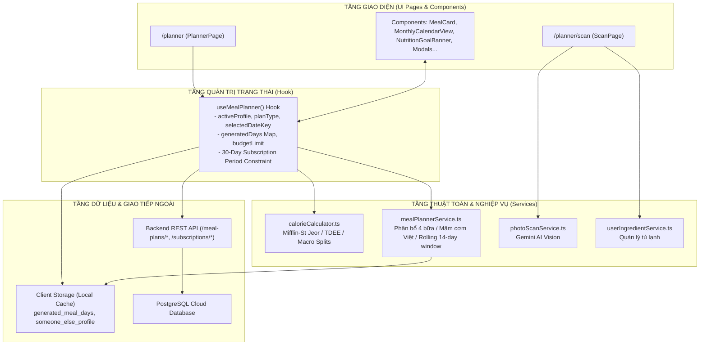

# BÁO CÁO PHÂN TÍCH TOÀN DIỆN MÃ NGUỒN FRONTEND MODULE MEAL PLAN (VEGGIEHUB)

---

## 1. TỔNG QUAN KIẾN TRÚC MODULE MEAL PLAN

Module **Meal Plan** (Kế hoạch thực đơn chay cá nhân hóa) là một trong những tính năng cốt lõi và phức tạp nhất của nền tảng VeggieHub. Hệ thống được xây dựng để giải quyết bài toán: **Tính toán khoa học nhu cầu năng lượng (BMR, TDEE, Calorie Target) dựa trên chỉ số sinh học của người dùng, từ đó đề xuất mâm cơm chay 4 bữa cân bằng dinh dưỡng, loại trừ dị ứng nghiêm ngặt, tối ưu ngân sách và đảm bảo tính đa dạng món ăn theo thời gian.**

### 1.1. Cấu trúc thư mục mã nguồn
```
frontend/
├── src/
│   ├── app/
│   │   └── planner/
│   │       ├── page.tsx                  # Giao diện chính màn hình Lập kế hoạch thực đơn
│   │       └── scan/
│   │           └── page.tsx              # Màn hình Quét ảnh tủ lạnh bằng AI (Gemini Vision)
│   └── features/
│       └── meal-planner/
│           ├── index.ts                  # Barrel export toàn bộ module
│           ├── types.ts                  # Toàn bộ Interface & Type định nghĩa dữ liệu
│           ├── data/
│           │   └── mockMealPlan.ts       # Dữ liệu dự phòng (fallback) ban đầu
│           ├── services/
│           │   ├── mealPlanApiService.ts    # Kết nối toàn bộ 12 REST API Backend
│           │   ├── mealPlannerService.ts    # Thuật toán sinh thực đơn, cân bằng calo, mâm cơm Việt
│           │   ├── photoScanService.ts      # Dịch vụ giao tiếp API AI Gemini quét ảnh nguyên liệu
│           │   └── userIngredientService.ts # Dịch vụ quản lý tủ lạnh nguyên liệu của người dùng
│           ├── hooks/
│           │   └── useMealPlanner.ts        # Custom Hook quản trị toàn bộ State & Logic nghiệp vụ
│           └── components/
│               ├── AddDishModal.tsx         # Modal thêm món thủ công vào từng bữa
│               ├── DailyMacroSummary.tsx    # Thanh chỉ số dinh dưỡng (Calo, Protein, Carbs, Fat)
│               ├── FavoritesModal.tsx       # Modal quản lý món yêu thích & thực đơn đã lưu
│               ├── GenerationSettingsModal.tsx # Modal tùy biến nâng cao (Ngân sách, Dị ứng, Chế độ chay)
│               ├── MealCard.tsx             # Thẻ hiển thị từng bữa ăn (Sáng, Trưa, Tối, Phụ)
│               ├── MealReplacementModal.tsx # Modal đổi món thông minh tương đương calo
│               ├── MonthlyCalendarView.tsx  # Lưới lịch tháng & Ràng buộc chu kỳ 30 ngày gói
│               ├── NutritionGoalBanner.tsx  # Banner mục tiêu sức khỏe, BMI, lời khuyên Bếp trưởng AI
│               ├── PlanForSomeoneElseModal.tsx # Modal thiết lập hồ sơ và lập kế hoạch cho người thân
│               └── SaveMealPlanModal.tsx    # Modal lưu thực đơn ngày vào danh sách yêu thích
```

### 1.2. Sơ đồ kiến trúc phân lớp & Luồng dữ liệu (Data Flow)



---

## 2. CHI TIẾT TỪNG TỆP & INTERFACE ĐỊNH NGHĨA (`types.ts`)

Tệp [`types.ts`](file:///C:/Users/as/Documents/SWP/VegetMealPlan/frontend/src/features/meal-planner/types.ts) quy định cấu trúc dữ liệu chuẩn mực cho toàn bộ hệ thống lập thực đơn.

| Tên Type / Interface | Mục đích & Chi tiết các trường |
| :--- | :--- |
| `MealPlanType` | Kiểu chu kỳ lập thực đơn: `"daily"` (1 ngày), `"weekly"` (tuần 7 ngày), `"monthly"` (tháng/chu kỳ gói 30 ngày). |
| `MealIngredientSummaryItem` | Thông tin tổng hợp nguyên liệu cho thực đơn: `ingredient_name` (tên), `quantity_g` (khối lượng gam ước tính), `note` (ghi chú sơ chế). |
| `MealSlotItem` | Đại diện cho một bữa ăn trong ngày: `recipe` (món chính đại diện), `recipes` (mảng các món trong mâm cơm bữa đó), `time` (khung giờ khuyến nghị ăn), `portion` (hệ số khẩu phần). |
| `DayMealPlan` | Kế hoạch dinh dưỡng trọn vẹn của 1 ngày: gồm 4 bữa (`breakfast`, `lunch`, `dinner`, `snack`), tổng dinh dưỡng thực tế (`totalCalories`, `totalProtein`, `totalCarbs`, `totalFat`), mục tiêu calo (`targetCalories`), calo còn lại (`remainingCalories`), chi phí dự kiến (`estimatedCost`), danh mục nguyên liệu (`ingredient_summary`), nhận xét của AI (`ai_cookability_notes`). |
| `CalendarDayMealPlan` | Mở rộng từ `DayMealPlan` để hiển thị trên Lưới Lịch tháng: bổ sung `dayOfMonth` (ngày trong tháng 1-31), `month` (tháng 0-11), `year` (năm), `dateKey` (chuỗi định danh `"YYYY-MM-DD"`), `isCurrentMonth` (cờ tháng hiện tại), `isOutOfSubscription` (cờ đánh dấu ngày vượt quá chu kỳ 30 ngày gói). |
| `WeeklyMealPlan` | Cấu trúc thực đơn tuần (Thứ 2 đến Chủ nhật): mảng `days: DayMealPlan[]`, trung bình calo/ngày, trung bình protein, tổng chi phí tuần, ngân sách tối đa `budgetLimit`. |
| `MonthlyMealPlan` | Cấu trúc thực đơn tháng: mảng `days: CalendarDayMealPlan[]`, tổng chi phí tháng, trung bình calo, `subscriptionPeriod` (chứa `startDateKey`, `endDateKey`, `totalDays` để kiểm soát giới hạn gói 30 ngày). |
| `GenerationPlanOptions` | Tham số tùy biến khi gọi AI sinh thực đơn: `planType`, `isSomeoneElse`, `targetProfile`, `budgetLimit`, `favoriteRecipeIds`, `recentRecipeIds` (danh sách món đã ăn trong 14 ngày gần nhất để chống lặp món). |
| `DetectedIngredient` & `ScanPreset` | Cấu trúc dữ liệu nguyên liệu nhận diện qua AI camera: tên nguyên liệu, độ tươi (`"Fresh"` / `"Use soon"`), độ tin cậy `confidence`, các món nấu được ngay. |

---

## 3. CHI TIẾT TẦNG DỊCH VỤ (SERVICES)

### 3.1. `mealPlanApiService.ts` — Cổng giao tiếp REST API Backend

Tệp [`mealPlanApiService.ts`](file:///C:/Users/as/Documents/SWP/VegetMealPlan/frontend/src/features/meal-planner/services/mealPlanApiService.ts) đóng gói 12 hàm API gọi đến Backend NestJS:

1. **`generateDaily(payload)`**: Gửi yêu cầu sinh thực đơn 1 ngày (3-4 bữa) khớp calo và có AI duyệt.
2. **`generateWeekly(payload)`**: Gửi yêu cầu sinh thực đơn 7 ngày tuần theo hồ sơ, chế độ ăn chay, ngân sách và dị ứng.
3. **`generateMonthly(payload)`**: Gửi yêu cầu sinh thực đơn tháng (ràng buộc không vượt quá ngày hết hạn gói).
4. **`validateMealPlan(payload)`**: Kiểm tra tính hợp lệ về dinh dưỡng và dị ứng khi người dùng tự tạo thực đơn từ danh sách món yêu thích.
5. **`generateForSomeone(payload)`**: Lập thực đơn cho người thân (dành cho tài khoản Premium), sử dụng profile riêng biệt.
6. **`getMyMealPlans()`**: Lấy danh sách các kế hoạch thực đơn đã lưu trong tài khoản cá nhân.
7. **`getMyMealPlanDetail(id)`**: Lấy chi tiết toàn bộ các ngày, các bữa và từng món ăn của một thực đơn đã lưu.
8. **`saveMealPlan(payload)`**: Lưu thực đơn hiện tại vào cơ sở dữ liệu để tái sử dụng.
9. **`updateMyMealPlan(id, payload)`**: Cập nhật tên thực đơn hoặc chuyển đổi trạng thái đang áp dụng (`is_active`).
10. **`deleteMyMealPlan(id)`**: Xóa bỏ một thực đơn đã lưu khỏi tài khoản.
11. **`getProfileAllergies(profileId)`** & **`setProfileAllergies(profileId, ingredient_ids)`**: Đọc và cập nhật danh sách dị ứng cho hồ sơ lập thực đơn của người thân.
12. **`updateMealSlot(planId, dayId, slotId, payload)`**: Đổi một món ăn cụ thể trong một bữa ăn đã lưu trên máy chủ.

---

### 3.2. `mealPlannerService.ts` — Bộ não tính toán & Thuật toán sinh thực đơn

Tệp [`mealPlannerService.ts`](file:///C:/Users/as/Documents/SWP/VegetMealPlan/frontend/src/features/meal-planner/services/mealPlannerService.ts) chịu trách nhiệm toàn bộ logic xử lý nghiệp vụ ở phía client:

#### Các hàm tiện ích & thuật toán cốt lõi:
- **`getCurrentWeekDates(refDate)`**: Tính toán chính xác 7 ngày trong tuần (Thứ 2 đến Chủ nhật) dựa trên ngày mốc truyền vào, đảm bảo tuân thủ tiêu chuẩn lịch Việt Nam.
- **`recalculateDay(day, targetCalories, userId)`**:
  - Duyệt qua tất cả 4 bữa ăn của một ngày, gom tất cả các món ăn (kể cả món chính và món phụ).
  - Tính tổng Calo, Protein, Carbs, Fat và tổng chi phí (`estimatedCost`).
  - Tính toán lượng calo chênh lệch so với mục tiêu (`remainingCalories = targetCalories - totalCalories`).
  - Tự động tổng hợp danh mục nguyên liệu theo gam cho toàn bộ ngày đó (`ingredient_summary`).
- **`generateDayPlan(dayInfo, profile, daySeed, offset, options)`**:
  - **Bước 1**: Lấy mục tiêu dinh dưỡng từ `calculateDailyCalorieTarget(profile)` (tính theo công thức Mifflin-St Jeor nhân hệ số vận động PAL).
  - **Bước 2**: Chia tỷ lệ calo chuẩn cho 4 bữa:
    - Bữa Sáng: $20\% - 25\%$ tổng calo
    - Bữa Trưa: $35\% - 40\%$ tổng calo
    - Bữa Tối: $30\% - 35\%$ tổng calo
    - Bữa Phụ (Snack): $5\% - 10\%$ tổng calo
  - **Bước 3 - Cấu trúc mâm cơm chuẩn Việt**:
    - Bữa Sáng: Ưu tiên bún, phở, mì chay hoặc bánh/xôi nhanh gọn.
    - Bữa Trưa & Tối: Kết hợp mâm cơm gia đình gồm **1 Món mặn/kho/rim/xào** + **1 Món canh/súp thanh mát** + **Cơm/món ăn kèm**.
  - **Bước 4 - Lọc điều kiện khắt khe**:
    - Loại bỏ tuyệt đối các món chứa thành phần người dùng bị dị ứng (`profile.allergies`).
    - Lọc nghiêm ngặt theo trường phái ăn chay: Thuần chay (Vegan), Chay có sữa (Lacto), Chay có trứng (Ovo), hoặc Chay trứng sữa (Ovo-Lacto).
    - Ưu tiên các món nằm trong danh sách yêu thích của người dùng (`favoriteRecipeIds`).
    - Kiểm tra danh sách món ăn trong 14 ngày gần nhất (`recentRecipeIds`) để **không lặp lại món ăn gây ngán**.
- **`generateWeeklyPlan(profile, seed, options)`**:
  - Lặp qua 7 ngày trong tuần, duy trì một danh sách trượt 14 ngày (`rolling14Days`) để các ngày trong tuần không bị trùng món.
  - Tính toán tổng chi phí cả tuần và kiểm tra với giới hạn ngân sách `budgetLimit`.
- **`generateMonthlyPlan(profile, year, month, seed, options)`**:
  - Sinh kế hoạch thực đơn cho toàn bộ các ngày hợp lệ trong tháng hoặc chu kỳ gói.
- **`createEmptyMonthlyPlan(year, month)`**:
  - Tạo khung lịch tháng trống với đầy đủ 28-31 ngày để hiển thị calendar khi người dùng chưa bấm tạo thực đơn.
- **`validateAndCreateFromFavorites(selectedRecipes, profile)`**:
  - Kiểm tra dinh dưỡng khi người dùng tự bốc món từ kho Yêu thích. Đánh giá xem tổng calo có đạt dải an toàn (80% - 115% mục tiêu) hay không.
- **`balanceDayFromFavorites(selectedRecipes, profile)`**:
  - Thuật toán thông minh: Nếu người dùng chỉ chọn 1 hoặc 2 món yêu thích, hàm này sẽ tự động tìm kiếm và bổ sung các món còn thiếu (canh, món xào hoặc tráng miệng) để làm tròn đủ 4 bữa và khớp chuẩn calo mục tiêu.
- **`convertBackendWeeklyPlan` & `convertBackendMonthlyPlan`**:
  - Bộ chuyển đổi (Adapter) dữ liệu JSON từ API Backend sang định dạng Entity hiển thị của Frontend.

---

### 3.3. `photoScanService.ts` — Tích hợp Trí tuệ Nhân tạo Gemini Vision

Tệp [`photoScanService.ts`](file:///C:/Users/as/Documents/SWP/VegetMealPlan/frontend/src/features/meal-planner/services/photoScanService.ts) đảm nhận:
- **`detect(file: File)`**: Đóng gói ảnh chụp tủ lạnh vào `FormData` gửi lên endpoint `POST /meal-plans/scan/detect`. Backend gọi model Gemini Vision để phân tích hình ảnh, phát hiện các loại rau củ, đậu hũ, nấm... và đánh giá độ tươi (Fresh / Use soon).
- **`confirm(items)`**: Lưu các nguyên liệu đã xác nhận sau khi quét vào tủ lạnh ảo của người dùng.
- **`getStats()`**: Kiểm tra giới hạn số lượt quét ảnh miễn phí còn lại trong ngày.

---

### 3.4. `userIngredientService.ts` — Quản trị Tủ lạnh Thông minh

Tệp [`userIngredientService.ts`](file:///C:/Users/as/Documents/SWP/VegetMealPlan/frontend/src/features/meal-planner/services/userIngredientService.ts) xử lý dữ liệu nguyên liệu:
- **`getSystemIngredients()`**: Tải danh mục nguyên liệu chuẩn hệ thống (kèm calo/100g, giá thị trường, cờ thuần chay).
- **`getMyIngredients()`**: Tải danh sách thực phẩm trong tủ lạnh của user, tự động đồng bộ vào `localStorage` (`user_pantry_ingredients`) để người dùng có thể xem offline.
- **`addIngredient(payload)`** & **`removeIngredient(id)`**: Thêm/xóa nguyên liệu tủ lạnh, tự động fallback lưu cục bộ nếu mất kết nối mạng.

---

## 4. CHI TIẾT TẦNG QUẢN TRỊ TRẠNG THÁI (`hooks/useMealPlanner.ts`)

Hook [`useMealPlanner.ts`](file:///C:/Users/as/Documents/SWP/VegetMealPlan/frontend/src/features/meal-planner/hooks/useMealPlanner.ts) là trung tâm điều khiển toàn bộ nghiệp vụ của trang Planner.

### 4.1. Các State quản trị:
1. `planType`: Chế độ xem hiện tại (`"daily"` | `"weekly"` | `"monthly"`). Mặc định là `"monthly"`.
2. `selectedDateKey`: Ngày đang được chọn chi tiết trên giao diện (chuỗi định dạng `"YYYY-MM-DD"`).
3. `activeDayIndex`: Thứ tự ngày đang chọn trong tuần (0-6) hoặc trong tháng.
4. `selectedMonth` & `selectedYear`: Tháng và năm đang được hiển thị trên lịch.
5. `generatedDays`: Đối tượng lưu trữ toàn bộ thực đơn theo ngày dạng bảng băm `Record<string, CalendarDayMealPlan>`. Dữ liệu được đồng bộ liên tục với `localStorage` qua khóa `STORAGE_KEYS.GENERATED_MEAL_DAYS`.
6. `budgetLimit`: Ngân sách chi tiêu tối đa (VNĐ) do người dùng thiết lập.
7. `isGenerating`: Trạng thái loading khi AI đang tính toán tạo thực đơn.
8. `generationFeedback`: Chuỗi thông báo kết quả (thành công hoặc lỗi) hiển thị cho người dùng.
9. `someoneElseProfile` & `isPlanForSomeoneElse`: Quản lý hồ sơ người thân khi kích hoạt chế độ "Lập cho người khác".

### 4.2. Ràng buộc chu kỳ 30 ngày của gói đăng ký (Subscription Period Constraint)
- **`subPeriod`**: Lấy thông tin từ `subscriptionService.getSubscriptionPeriod()`, bao gồm `startDateKey`, `endDateKey` và `totalDays` (chuẩn 30 ngày).
- **Ràng buộc Navigation Tháng Sau (`canNextMonth`)**:
  ```ts
  const nextMonthNum = selectedMonth === 11 ? 0 : selectedMonth + 1;
  const nextYearNum = selectedMonth === 11 ? selectedYear + 1 : selectedYear;
  const firstDayOfNextMonthKey = `${nextYearNum}-${String(nextMonthNum + 1).padStart(2, "0")}-01`;
  const canNextMonth = monthDiff < 1 && firstDayOfNextMonthKey <= subPeriod.endDateKey;
  ```
  *Nguyên lý*: Nút chuyển tháng `>` chỉ sáng nếu ngày đầu tiên của tháng tiếp theo **vẫn còn nằm trong chu kỳ 30 ngày của gói**. Nếu gói hết hạn trước tháng sau, nút `>` sẽ bị vô hiệu hóa hoàn toàn.
- **`monthlyPlan` Memoized**:
  - Tự động gắn cờ `isOutOfSubscription = dateKey > subPeriod.endDateKey` cho từng ngày trên lịch.
  - Trả về thông tin `subscriptionPeriod` để UI Calendar hiển thị.

### 4.3. Các hàm hành động (Action Handlers):
- **`generateDaily(options)`**: Tạo thực đơn 1 ngày duy nhất cho ngày đang chọn (`selectedDateKey`). Bỏ qua nếu là ngày trong quá khứ.
- **`generateWeekly(options)`**: Tạo thực đơn cho các ngày còn lại trong tuần (từ hôm nay đến Chủ nhật).
- **`generateMonthly(month, year, options, onComplete)`**:
  - Kiểm tra hạn gói: Nếu gói đã hết hạn, chặn lại và thông báo yêu cầu gia hạn.
  - Thu thập danh sách các ngày hợp lệ tính từ **hôm nay đến đúng ngày hết hạn gói (`subPeriod.endDateKey`)**, tối đa 30 ngày.
  - Lặp qua từng ngày, gọi `mealPlannerService.generateDayPlan` luân chuyển món bằng cửa sổ trượt 14 ngày.
  - Lưu kết quả vào `generatedDays`. Tuyệt đối không sinh món cho bất kỳ ngày nào sau ngày hết hạn gói.
- **`replaceMeal(dayIdx, mealSlot, newRecipe, recipeIndex)`**:
  - Đổi món trong 1 bữa ăn.
  - Ràng buộc: Chặn thao tác nếu ngày này đã vượt quá hạn gói (`targetDateKey > subPeriod.endDateKey`).
  - Gọi `mealPlannerService.recalculateDay` để tự động tính lại tổng calo, protein, carbs, fat sau khi đổi món.
- **`regenerateSingleDay(index)`**:
  - Tạo lại toàn bộ 4 bữa ăn cho 1 ngày cụ thể.
  - Chặn nếu là ngày trong quá khứ hoặc ngày đã hết hạn gói.
- **`saveCurrentMealPlan(name)`**:
  - Lưu thực đơn của ngày đang chọn vào danh mục Yêu thích (`favoriteService.saveFavoritePlan`).

---

## 5. CHI TIẾT CÁC THÀNH PHẦN GIAO DIỆN (COMPONENTS)

### 5.1. `MonthlyCalendarView.tsx` — Lưới Lịch Tháng Thông Minh
- **Hiển thị ma trận 7 cột (T2 - CN)**: Tự động tính toán các ô trống đầu tháng (`leadingBlankDays`) dựa trên ngày đầu tiên của tháng.
- **Phân loại trạng thái từng ô ngày**:
  1. *Ngày đã qua*: Gạch ngang số ngày, nền xám mờ, hiển thị chữ "Đã qua", cấm click.
  2. *Ngày hết hạn gói (🔒)*: Kích hoạt khi `day.isOutOfSubscription = true`. Ô ngày bị mờ, có icon ổ khóa và nhãn "Hết hạn gói", không thể click đổi món hay tạo món.
  3. *Ngày đã tạo thực đơn*: Nền xanh ngọc nhạt, viền xanh, hiển thị calo (`~1800 kcal`) và chi phí ước tính.
  4. *Ngày trống (chưa tạo)*: Nền trắng, viền xám, hiển thị chữ "Trống", click để xem chi tiết.
- **Header Lịch**:
  - Nút `<` và `>` chuyển tháng. Nút `>` tự động khóa kèm tooltip giải thích nếu tháng sau nằm ngoài gói đăng ký.
  - Thẻ thống kê: Hiển thị chu kỳ gói 30 ngày, số ngày đã tạo, tổng tiền và mức calo trung bình ngày.

### 5.2. `NutritionGoalBanner.tsx` — Banner Chỉ Số & Lời Khuyên Bếp Trưởng AI
- Hiển thị thông tin hồ sơ dinh dưỡng: Tên người dùng / người thân, Chế độ ăn chay hiện tại.
- Thẻ đo lường thể chất: Chỉ số BMI, Trọng lượng hiện tại, Nhu cầu chuyển hóa cơ bản BMR, Mức tiêu hao năng lượng TDEE và Mục tiêu Calo/ngày.
- **AI Chef Advice**: Khối hiển thị lời khuyên nấu ăn từ Bếp trưởng AI (Groq AI) về cách phối hợp gia vị chay, mẹo nấu và bảo quản thực phẩm.
- Nút "Chỉnh sửa hồ sơ" hoặc "Đổi người" để mở drawer cập nhật chỉ số thể chất.

### 5.3. `DailyMacroSummary.tsx` — Bảng Phân Tích Dinh Dưỡng Chi Tiết
- Thanh tiến trình Calo trực quan: So sánh lượng Calo nạp vào với Calo mục tiêu. Màu sắc tự động biến đổi (Xanh lá: Đạt chuẩn $\pm 10\%$, Vàng: Thiếu calo, Đỏ: Vượt calo).
- 3 Đồng hồ dinh dưỡng đa lượng (Macronutrients):
  - **Protein**: Tính theo gam và % năng lượng (chuẩn $15\% - 25\%$).
  - **Carbs (Tinh bột)**: Tính theo gam và % năng lượng (chuẩn $50\% - 65\%$).
  - **Fat (Chất béo lành mạnh)**: Tính theo gam và % năng lượng (chuẩn $20\% - 30\%$).

### 5.4. `MealCard.tsx` — Thẻ Quản Lý Từng Bữa Ăn
- Đại diện cho 1 bữa ăn (Sáng, Trưa, Tối, Phụ).
- Hiển thị hình ảnh món ăn chất lượng cao, tên món, nhãn trường phái ăn chay, thời gian nấu, mức calo và giá thành.
- Hỗ trợ hiển thị mâm cơm nhiều món: Liệt kê danh sách từng món trong bữa (Món chính, Canh, Món xào).
- Nút tác vụ nhanh:
  - **Đổi món**: Mở modal chọn món thay thế tương đương calo.
  - **Thêm món**: Mở modal thêm món mới vào mâm cơm bữa đó.
  - **Xem công thức**: Chuyển hướng tới trang chi tiết công thức nấu ăn.

### 5.5. `MealReplacementModal.tsx` — Đổi Món Thông Minh Khớp Calo
- Cho phép người dùng tìm kiếm món thay thế cho một món bất kỳ trong bữa ăn.
- Lọc theo thanh dải calo (mặc định gợi ý các món chênh lệch không quá $\pm 15\%$ so với món cũ để giữ cân bằng tổng calo ngày).
- Bộ lọc danh mục (Mì bún phở, Món kho, Canh súp, Xào chiên...) và lọc trường phái ăn chay.
- Loại trừ tự động tất cả các món chứa chất dị ứng của người dùng.

### 5.6. `FavoritesModal.tsx` — Quản Lý Yêu Thích & Thực Đơn Mẫu
- **Tab 1: Món ăn yêu thích**: Danh sách các món ăn người dùng đã đánh dấu tim. Cung cấp tính năng chọn 3-4 món bất kỳ để AI tự động cân bằng và tạo ra thực đơn 1 ngày hoàn chỉnh.
- **Tab 2: Mẫu thực đơn đã lưu**: Danh sách các mẫu thực đơn (ngày/tuần/tháng) đã lưu. Người dùng có thể bấm "Áp dụng vào lịch", xem chi tiết 4 bữa ăn của mẫu thực đơn, đổi tên mẫu hoặc xóa bỏ.

### 5.7. `PlanForSomeoneElseModal.tsx` — Lập Kế Hoạch Cho Người Thân
- Giải pháp tuyệt vời dành cho người chăm sóc gia đình (cha mẹ, vợ chồng, con cái).
- Biểu mẫu nhập liệu: Họ tên, Giới tính, Năm sinh, Chiều cao, Cân nặng, Mức độ vận động thể lực.
- Chọn trường phái ăn chay riêng và các dị ứng riêng biệt của người thân.
- Tự động tính toán chỉ số BMI, BMR, TDEE và Calo mục tiêu cho người đó.
- Lưu trữ vào `someoneElseProfile` và kích hoạt chế độ lập thực đơn riêng biệt, có banner thông báo rõ ràng trên đầu trang.

### 5.8. `GenerationSettingsModal.tsx` & `SaveMealPlanModal.tsx`
- **`GenerationSettingsModal`**: Cấu hình nâng cao trước khi bấm tạo thực đơn: Nhập trần ngân sách chi tiêu tối đa (VNĐ), chọn có áp dụng món yêu thích hay không, hiển thị các cảnh báo sức khỏe nếu mục tiêu giảm cân/tăng cân quá nhanh.
- **`SaveMealPlanModal`**: Hộp thoại xác nhận lưu thực đơn của ngày đang chọn: Đặt tên mẫu thực đơn, hiển thị tổng calo, tổng chi phí và danh sách các món ăn trong 4 bữa trước khi lưu.

---

## 6. CHI TIẾT CÁC TRANG ỨNG DỤNG (PAGES)

### 6.1. `app/planner/page.tsx` — Màn Hình Trung Tâm Lập Thực Đơn
- **Điều phối Tab chế độ xem**:
  - Chuyển đổi linh hoạt giữa 3 chế độ: Theo Ngày (`daily`), Theo Tuần (`weekly`) và Lịch Tháng (`monthly`).
- **Khối Điều Khiển Sinh Món (Generation Control Bar)**:
  - Cung cấp ô nhập nhanh giới hạn ngân sách chi tiêu.
  - Các nút mở Modal: "Món yêu thích", "Thực đơn đã lưu", "Cài đặt nâng cao", "Lập cho người khác".
  - 3 nút hành động chính xếp hàng dọc nổi bật: **Tạo Thực Đơn Ngày**, **Tạo Kế Hoạch Tuần**, **Tạo Kế Hoạch Tháng**.
- **Cơ chế Bảo vệ Bản quyền Premium (`requirePremium`)**:
  - Tích hợp với `PremiumGuard` / `useSubscription`. Khi người dùng miễn phí bấm vào các tính năng nâng cao (Tạo tuần, Tạo tháng, Lập cho người thân, Đổi món), hệ thống tự động kích hoạt `PremiumUpgradeModal` để hướng dẫn nâng cấp gói.
- **Khu vực hiển thị nội dung chính**:
  - Khi xem chế độ Tháng: Hiển thị `MonthlyCalendarView` ở trên, bên dưới là chi tiết 4 bữa ăn (`MealCard`) của ngày đang được chọn trên lịch.
  - Khi xem chế độ Tuần: Hiển thị thanh 7 tab thứ trong tuần kèm tóm tắt calo từng ngày.

### 6.2. `app/planner/scan/page.tsx` — Quét Ảnh Tủ Lạnh Bằng AI Camera
- **Tải ảnh linh hoạt**: Hỗ trợ chụp ảnh trực tiếp từ camera điện thoại/laptop hoặc kéo thả ảnh chụp tủ lạnh có sẵn.
- **Nhận diện tự động qua Gemini Vision**:
  - Gửi ảnh đến AI để phát hiện tất cả các loại rau củ, củ quả, đậu phụ, gia vị.
  - Phân loại độ tươi: Màu xanh lá cho đồ tươi mới, màu vàng cho đồ cần ăn sớm ("Use soon").
  - Đánh dấu cảnh báo nếu phát hiện nguyên liệu vi phạm dị ứng hoặc nghi ngờ không thuần chay.
- **Tương tác & Quản lý**:
  - Cho phép người dùng chỉnh sửa số lượng, đơn vị (gam, quả, miếng, bó).
  - Bấm "Lưu vào tủ lạnh" để cập nhật kho nguyên liệu.
  - Nút "Tìm món nấu ngay": Tự động lọc ra các công thức món chay trong cơ sở dữ liệu có thể nấu được ngay từ chính các nguyên liệu vừa quét được mà không cần đi chợ.

---

## 7. TỔNG KẾT VÀ GIÁ TRỊ CÔNG NGHỆ

Module **Meal Plan** của VeggieHub kết hợp nhuần nhuyễn giữa:
1. **Khoa học Dinh dưỡng Chính xác**: Sử dụng công thức chuyển hóa sinh học chuẩn quốc tế Mifflin-St Jeor và phân bổ đa lượng cân bằng.
2. **Trí tuệ Nhân tạo Đa phương thức (Multimodal AI)**: Tích hợp Google Gemini Vision cho việc phân tích ảnh tủ lạnh và Groq AI cho việc tư vấn chế biến thực đơn.
3. **Trải nghiệm Người dùng (UX) Chặt chẽ**: Kiểm soát chu kỳ gói 30 ngày chuẩn xác, chống trùng lặp món ăn 14 ngày, cơ chế lưu trữ offline bền bỉ qua localStorage và kiến trúc phân lớp sạch sẽ, dễ bảo trì và mở rộng.
